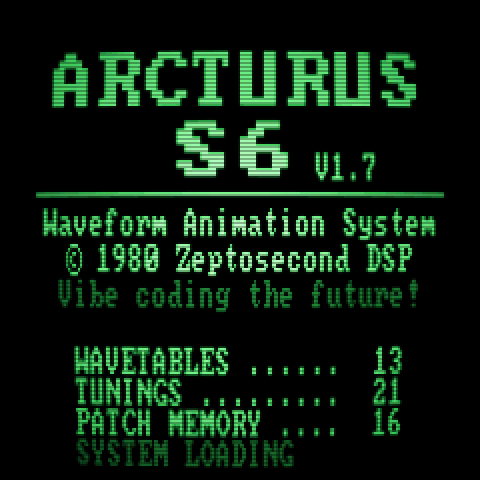
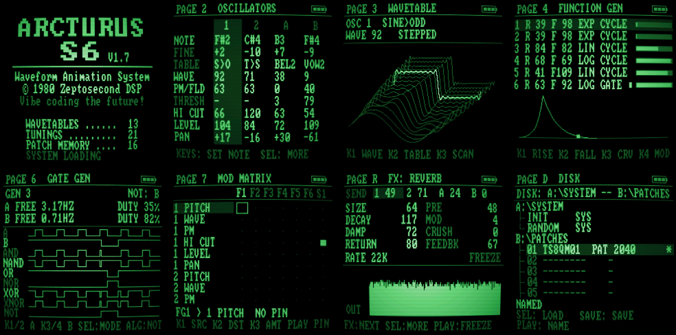

<p align="center"></p>

# Arcturus S6

**A Waveform Animation System for the M-VAVE FM-1.** An experimental, self-playing wavetable instrument for
generative, evolving soundscapes, with the sound and look of early digital machines.

Four PPG-style wavetable oscillators, no sequencer and no filter section: the movement comes from Serge-style
modulators patched into the oscillators, into each other and into themselves. The engine runs natively at 12 bit
and 22.05kHz on 8-bit wavetables, and the screen is a green phosphor CRT after the Fairlight CMI.

<p align="center"></p>

- **4 wavetable oscillators:** 1 and 2 phase-modulate each other, A and B have wavefolders; each has a 12dB hi cut, level and pan.
- **13 wavetables**, the last one generative (reroll it on the box); smooth or stepped scanning.
- **6 Serge-style function generators:** rise, fall, lin / exp / log curves, cycle / gate / once, end-of-cycle gates.
- **2 sample-and-holds** (noise or any modulator, slew) and a **quadrature LFO**.
- **4 gate generators:** two square LFOs each (free or MIDI clock) into AND, NAND, OR, NOR, XOR, XNOR and NOT.
- **An EMS-style mod matrix and a gate matrix**, feedback welcome.
- **21 tunings** (just intonation, shruti, Bohlen-Pierce, the Carlos scales and more) with per-oscillator quantisers.
- **Effects:** a low-rate plate reverb with freeze, a shift-register delay, a flanger, in any order.
- **16 named patches** on a DOS-style disk page, INIT and RANDOM on the keys, a random drone at every power-on.

**[Quick start guide](docs/QUICKSTART.md)**: getting around, page by page, and patch ideas (Krell, generative
melodies, rhythms from logic).

## Install

The easy way: the [FM-1 Firmware Hub](https://thefirmwarehub.com), in Chrome or Edge, installs it over USB with
one click, and takes you back to the official firmware or any other the same way.

By hand: download `arcturus-s6-X.Y.fwsc` from the [releases](../../releases), then

```sh
pip3 install mido python-rtmidi                # (Windows: not needed, see below)
python3 tools/fm1_install.py arcturus-s6-X.Y.fwsc
```

On Windows, put the `.fwsc`, `tools/fm1_install.py`, `tools/fm1_winmidi.py` and `tools/windows/install.bat` in one
folder, rename the firmware `arcturus-s6.fwsc` and double-click `install.bat` (it needs Python 3).

**If it won't start:** hold **OCT−** while switching on. That's the USB rescue: no sound, only the updater, so you
can install it again or install another firmware from the hub. Installing firmware is at your own risk.

## Status

Tested on one FM-1. It's an experimental instrument written by machine (Claude, by Anthropic) with human guidance:
expect rough edges, and tell us about them in the [issues](../../issues).

## Build it yourself

Arcturus S6 is built on [Dinghy](https://github.com/zvenson/dinghy), so it builds the same way: Linux on x86-64
(or Docker), Python 3 with Pillow, the JieLi toolchain and three files of the JieLi AC79 SDK.

```sh
pip3 install Pillow mido python-rtmidi
tools/get_toolchain.sh
git clone --depth 1 --branch AC79NN_SDK_V1.2.1_2023-12-13 \
    https://gitee.com/Jieli-Tech/fw-AC79_AIoT_SDK.git ~/fw-AC79_AIoT_SDK
./build.sh                                     # -> build/arcturus-s6.fwsc
tests/run_host.sh tests/scripts/demo.txt       # the firmware on your computer: build/host/*.wav and screen PNGs
```

GitHub builds every push to `main`, and a tag `vX.Y` builds, tests and publishes a release with a build
attestation. The firmware itself is [firmware/src/dinghy.c](firmware/src/dinghy.c) and
[firmware/src/verb.h](firmware/src/verb.h) (the effects); the wavetables and lookup tables come from
[tools/gen_tables.py](tools/gen_tables.py). Dinghy's own docs, for the platform under it: [docs/API.md](docs/API.md),
[docs/RULES.md](docs/RULES.md), [docs/MAKE-IT-YOURS.md](docs/MAKE-IT-YOURS.md).

## Credits and licence

GPL-3.0-only: you may change and share it, and whoever gets your firmware gets its source. Details in
[LICENSING.md](LICENSING.md).

Arcturus S6 by Zeptosecond DSP. Built on [Dinghy](https://github.com/zvenson/dinghy) by zvenson, on the platform of
[Felucca](https://github.com/hugelton/Felucca) by Leo Kuroshita (Hügelton Instruments) as
[SLOOP](https://github.com/isod89/sloop-fm1) (isod89) carries it, with the SMK-37 layer by M. Geisler (genkigenki)
and the loader's screen after [Skiff](https://github.com/illuminus5/skiff) (illuminus5). The screen font is
font8x8 by Daniel Hepper (public domain). Not made or endorsed by M-VAVE.
